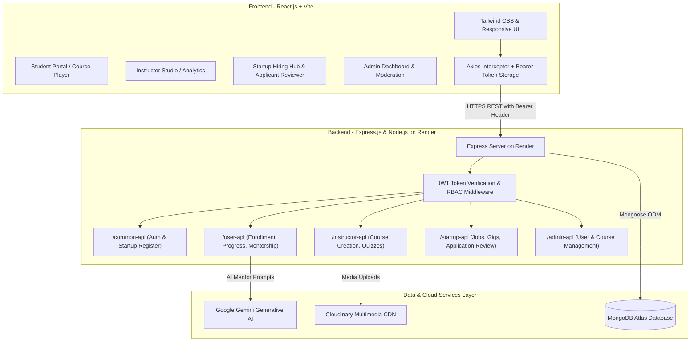
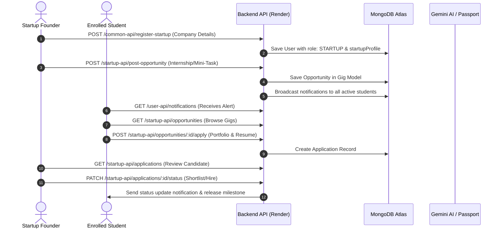
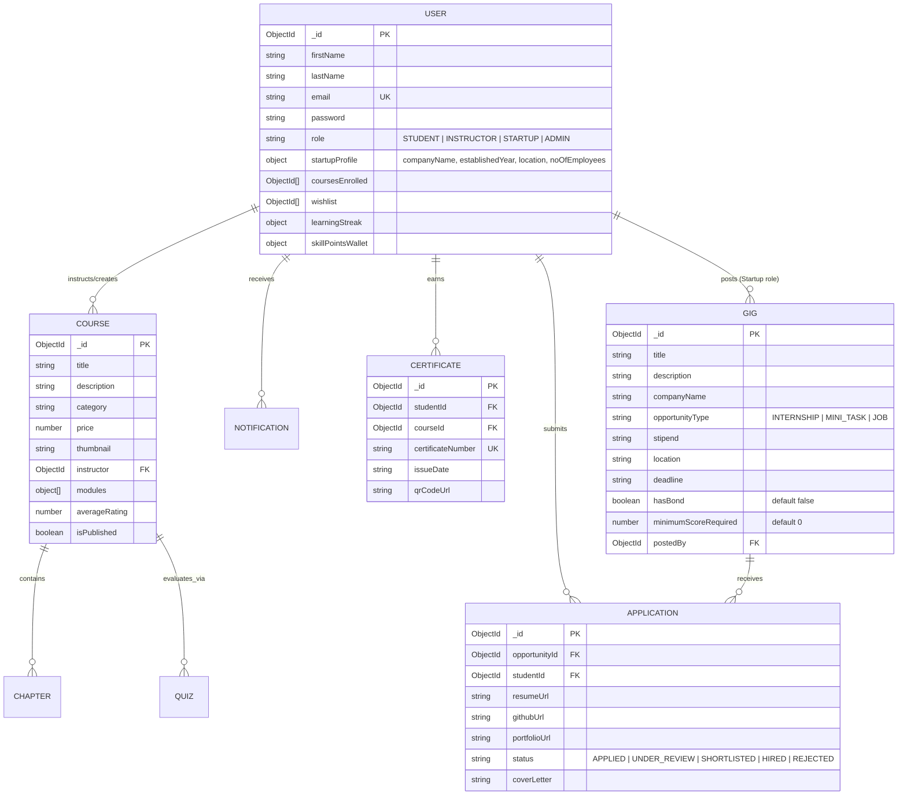

# ONLINE LEARNING PLATFORM (COURSEHUB)
## Comprehensive Technical Project Documentation & Academic Report

---

**Project Title:** Online Learning Platform with AI Mentorship & Startup Skill-to-Earn Micro-Internships  
**Student Name:** VADDIGALLA RISHIKANTH  
**Roll / Hall Ticket No:** 24EG512A04  
**Department:** Department of Information Technology  
**Institution:** Anurag University, Hyderabad, Telangana  
**Project Guide:** G. Sekhar Reddy, Assistant Professor  
**Academic Period:** 2023 – 2027  
**Live Deployed Application:**
- **Backend API (Render):** [https://online-learning-platofrm.onrender.com](https://online-learning-platofrm.onrender.com)
- **Source Code Repository:** [https://github.com/rishi1702-boop/Online_learning_platofrm](https://github.com/rishi1702-boop/Online_learning_platofrm)

---

## 1. Executive Summary & Abstract

The **Online Learning Platform (CourseHub)** is an enterprise-grade, full-stack Learning Management & Career Acceleration System developed using the **MERN Stack (MongoDB, Express.js, React.js, Node.js)**. Unlike conventional e-learning portals that stop at passive video streaming, CourseHub bridges the critical gap between academic learning and economic self-sufficiency.

Through an integrated **"Skill-to-Earn"** ecosystem, learners convert verified competencies directly into paid opportunities offered by registered startups. The platform features four dedicated user portals:
1. **Students:** Access video courses, modular chapters, real-time learning streak tracking, interactive assessments, QR-code verifiable certificates, and micro-internships with zero corporate bond restrictions.
2. **Instructors:** Create rich multimedia courses, upload resources to Cloudinary, design quizzes with AI-assistance, and monitor student performance analytics.
3. **Startups / Hiring Partners:** Register with dedicated corporate credentials (company name, founded year, location, employee count), post flexible paid mini-tasks and internships, broadcast instant notification alerts to qualified students, and hire talent without expensive recruitment intermediaries.
4. **Administrators:** Moderate user roles, resolve platform appeals, audit published courses, and monitor platform-wide KPIs.

The backend is deployed as a Dockerized Node.js Web Service on **Render**, backed by **MongoDB Atlas** and **Cloudinary CDN**, while the frontend is optimized for **Vercel** with client-side SPA rewrites and cross-domain token authorization.

---

## 2. Problem Statement

1. **Passive Learning without Economic Conversion:** Traditional LMS solutions (Coursera, Udemy) focus solely on course consumption. Students accumulate certificates without gaining real-world work experience or earning supplemental income.
2. **Corporate Hiring Barriers & High Filtering:** Multinational Corporations (MNCs) impose steep filtration bars (e.g., 90%+ academic criteria, aptitude screenings, long hiring cycles, and restrictive employment bonds) that disadvantage budding students.
3. **Prohibitive Production Costs for Startups:** Early-stage startups lack the capital to hire senior engineering talent for modular, discrete tasks that capable learners could solve.
4. **Credential Fraud & Lack of Verification:** Paper and static PDF certificates are frequently forged. Institutions need a tamper-proof verification mechanism.
5. **Monolithic & Complex Systems:** Legacy university portals suffer from poor user experience, lack of mobile responsiveness, and rigid navigation.

---

## 3. Project Objectives

- **Develop a Scalable Full-Stack Architecture:** Employ the MERN stack with strict modularity, RESTful conventions, and clean separation of concerns.
- **Implement Multi-Role RBAC:** Secure access control for **Students**, **Instructors**, **Startups**, and **Administrators** via JSON Web Tokens (JWT) and dual cookie/header authorization.
- **Build the Startup "Skill-to-Earn" Engine:** Enable startups to publish paid mini-tasks and internships with milestone-based stipends, removing arbitrary 90% score gates to promote experiential learning.
- **Integrate AI Capabilities:** Connect **Google Gemini AI** for real-time learner guidance and automated quiz assessment generation.
- **Implement Verifiable Digital Credentials:** Generate cryptographic completion certificates with unique hashes and scannable QR codes verifiable at `/verify-certificate`.
- **Cloud Infrastructure & Production Deployment:** Configure continuous deployment pipeline with Render and Vercel, handling cross-site CORS and cookie policies.

---

## 4. Literature Survey

| S.No | Author(s) & Year | Research Paper / Domain | Key Contribution | Gap Addressed in CourseHub |
|---|---|---|---|---|
| 1 | S. Aljawarneh et al. (2020) | *An Integrated E-Learning Management System* | Web-based LMS architecture and student engagement metrics. | Lacked practical monetizable outcomes for learners. CourseHub adds the Startup Gig marketplace. |
| 2 | J. Ellis (2019) | *Learning Management Systems Architecture* | Defined modern LMS requirements: modular curriculum, tracking. | Did not account for multi-stakeholder hiring partners. CourseHub introduces a dedicated Startup portal. |
| 3 | P. Ramkumar et al. (2021) | *Cloud-Based Online Learning Platform* | Scalable cloud hosting and media distribution in e-learning. | Addressed in CourseHub via Cloudinary CDN and Render cloud microservices. |
| 4 | M. Ali et al. (2022) | *Secure Authentication in E-Learning* | Role-based authentication security models and session policies. | CourseHub implements dual JWT authentication (Bearer headers + HTTP-only cookies). |
| 5 | R. Kumar & S. Singh (2023) | *Web-Based Educational Portal with Assessments* | Automated quizzing and learner performance analysis. | CourseHub enhances quizzes with AI-assisted generation and skill badges. |
| 6 | A. Sharma et al. (2024) | *MERN Stack for Scalable Enterprise Applications* | Evaluated Node.js non-blocking I/O and React Virtual DOM performance. | Adopted as CourseHub's foundational technology stack. |

---

## 5. System Architecture & Workflow

### 5.1 Three-Tier Architecture

### 5.2 Micro-Internship & Skill-to-Earn Workflow

---

## 6. Core Modules & Functionality

### 6.1 Authentication & Authorization Module
- **Granular Roles:** `STUDENT`, `INSTRUCTOR`, `STARTUP`, `ADMIN`.
- **Dedicated Startup Registration:** Collects essential organizational metadata:
  - **Company / Startup Name**
  - **Established Year** (validated between 1950 and current year)
  - **Headquarters / Location**
  - **Number of Employees** (`1-10 Early Stage`, `11-50 Growth`, `51-200 Scaleup`, `200+ Enterprise`)
  - Official work email, founder name, and company website.
- **Dual-Token Transport:** Operates seamlessly across domains by emitting an HTTP-only secure cookie and returning a signed JWT in the JSON payload for `Authorization: Bearer <token>` client headers.

### 6.2 Learning & Course Delivery Module
- **Curriculum Player:** Video lectures streamed from Cloudinary with chapter progress tracking, playback speed controls, and auto-completion triggers.
- **Wishlist & Enrollment:** Dynamic course catalog with category filters, ratings, search, and instant enrollment.
- **Course Notes & Discussion:** Chapter-specific study notes and instructor announcements.

### 6.3 Startup "Skill-to-Earn" Module
- **Zero-Barrier Micro-Tasks:** Removes obsolete 90% score gates so any motivated student who masters a skill can undertake project tasks.
- **Zero-Bond Assurance:** Gigs are strictly marked `hasBond: false` with flexible milestones designed for university academic schedules.
- **Broadcast Notifications:** Instant notification dispatched to skill-passport qualified students whenever a startup posts a gig.
- **Applicant Evaluation Portal:** Startups review applicant GitHub profiles, portfolios, cover letters, and select candidates with real-time status updates.

### 6.4 AI Mentorship & Assessment Module
- **Interactive AI Mentor:** Integrated chatbot powered by Google Gemini, answering course queries, explaining code snippets, and recommending personalized learning paths.
- **Quiz Generator:** Instructors can generate multiple-choice quizzes manually or with AI, evaluating student comprehension with automatic grading.

### 6.5 Digital Verification Module
- **Dynamic Certificate Generation:** Built with `jsPDF` and `html2canvas` upon 100% course curriculum completion.
- **QR Code Cryptographic Verification:** Each certificate embeds a verification link (`/verify-certificate?id=...`) validating issuer, completion date, student identity, and course details.

---

## 7. Database Architecture & Schema Design

---

## 8. RESTful API Specification

| Endpoint | HTTP Method | Access Role | Description |
|---|---|---|---|
| `/common-api/register` | `POST` | Public | Registers standard learners, instructors, or admins |
| `/common-api/register-startup` | `POST` | Public | Dedicated registration for startups with company metadata |
| `/common-api/login` | `POST` | Public | Authenticates credentials, issues JWT token and cookie |
| `/common-api/logout` | `POST` | Authenticated | Clears authorization session cookies |
| `/user-api/profile` | `GET` | `STUDENT` | Retrieves learner progress, streaks, and enrolled courses |
| `/user-api/enroll/:courseId` | `POST` | `STUDENT` | Enrolls student into course |
| `/user-api/notifications` | `GET` | Authenticated | Fetches user notifications (gigs, jobs, updates) |
| `/user-api/ai-chat` | `POST` | `STUDENT` | Prompts Gemini AI Mentor with academic questions |
| `/instructor-api/create-course` | `POST` | `INSTRUCTOR` | Publishes a new course with multimedia attachments |
| `/instructor-api/my-courses` | `GET` | `INSTRUCTOR` | Retrieves courses created by the authenticated instructor |
| `/instructor-api/analytics` | `GET` | `INSTRUCTOR` | Aggregates revenue, enrollments, and ratings |
| `/startup-api/post-opportunity` | `POST` | `STARTUP` | Posts an internship, mini-task, or job opening |
| `/startup-api/my-postings` | `GET` | `STARTUP` | Lists opportunities posted by the startup |
| `/startup-api/applications` | `GET` | `STARTUP` | Views all student applicants with resumes & portfolios |
| `/startup-api/applications/:id/status`| `PATCH` | `STARTUP` | Updates hiring status (Shortlisted, Hired, etc.) |
| `/admin-api/overview` | `GET` | `ADMIN` | Fetches platform analytics, revenue, and active counts |
| `/admin-api/users` | `GET` | `ADMIN` | Lists all users with ban/unban moderation actions |
| `/health` | `GET` | Public | Uptime healthcheck for Render monitoring |

---

## 9. Hardware & Software Requirements

### 9.1 Software Requirements
- **Operating System:** Windows 10/11, macOS Sequoia, or Ubuntu Linux 22.04 LTS
- **Runtime Environment:** Node.js v20.x / v22.x LTS, npm v10.x+
- **Frontend Stack:** React 19, Vite 7, Tailwind CSS 4, React Router 7, Axios, Lucide/React Icons
- **Backend Stack:** Express.js 5, Mongoose 9, JWT, bcrypt, cookie-parser, cors, dotenv
- **Cloud Database:** MongoDB Atlas (M0/M10 Cluster)
- **Object Storage / CDN:** Cloudinary Cloud Media Pipeline
- **AI Engine:** Google Gemini Generative AI SDK (`@google/genai`)
- **Deployment Targets:** Render (Web Service for Backend) & Vercel (SPA for Frontend)

### 9.2 Hardware Requirements
- **Processor:** Intel Core i3 / AMD Ryzen 3 / Apple Silicon M-Series or higher
- **System Memory (RAM):** 8 GB minimum (16 GB recommended for local containerized dev)
- **Disk Storage:** Minimum 20 GB free space
- **Network Bandwidth:** Broadband / High-speed Wi-Fi connection (10 Mbps+)
- **Display Resolution:** 1366 × 768 or higher (Responsive tested up to 4K Ultra HD)

---

## 10. Project Implementation Timeline (Gantt Chart)

| Phase / Activity | W1 | W2 | W3 | W4 | W5 | W6 | W7 | W8 | W9 | W10 | W11 | W12 |
|---|:---:|:---:|:---:|:---:|:---:|:---:|:---:|:---:|:---:|:---:|:---:|:---:|
| **Requirement Gathering & Feasibility Analysis** | ✔ | ✔ | | | | | | | | | | |
| **Database Schema & Data Model Design** | | ✔ | ✔ | | | | | | | | | |
| **Authentication & RBAC Implementation** | | | ✔ | ✔ | | | | | | | | |
| **Course Creation & Multimedia CDN Integration** | | | | ✔ | ✔ | | | | | | | |
| **Video Player & Progress Tracking Engine** | | | | | ✔ | ✔ | | | | | | |
| **Startup "Skill-to-Earn" Gig Marketplace** | | | | | | ✔ | ✔ | | | | | |
| **AI Mentor (Gemini) & Quiz Engine** | | | | | | | ✔ | ✔ | | | | |
| **QR Certificate Verification System** | | | | | | | | ✔ | ✔ | | | |
| **End-to-End Integration & Security Audits** | | | | | | | | | ✔ | ✔ | | |
| **Cloud Deployment (Render & Vercel)** | | | | | | | | | | ✔ | ✔ | |
| **Documentation & Final Project Report** | | | | | | | | | | | ✔ | ✔ |

---

## 11. Security & Quality Assurance

1. **Password Hashing:** Passwords are encrypted using `bcrypt` with salt rounds set to 10. Raw passwords are never stored or returned in JSON responses.
2. **Dual-Layer Authorization:** Protected routes check both `req.cookies.token` and `req.headers.authorization`, ensuring Safari ITP cross-site tracking policies do not lock out authenticated users.
3. **Role-Based Guards (`ProtectedRoute.jsx`):** Unauthorized users attempting to navigate to `/admin-dashboard`, `/instructor-dashboard`, or `/startup-dashboard` are dynamically redirected based on their verified role.
4. **Input Sanitization & Schema Validation:** Mongoose strict typing and regex email checks prevent NoSQL injection and data corruption.
5. **CORS Security:** Permissive for valid staging/production origins (`*.vercel.app`, `localhost`), rejecting arbitrary unauthorized third-party scripts.

---

## 12. Expected Outcomes & Impact

- **For Students:** Immediate transformation from passive learners into paid junior contributors, earning milestone stipends while completing degree coursework.
- **For Startups:** Drastically reduced engineering and design costs by delegating modular micro-tasks to motivated students with zero corporate legal overhead or bonds.
- **For Instructors:** Comprehensive creator studio to monetize knowledge, analyze enrollments, and engage students with interactive quizzes.
- **For Educational Institutions:** A transparent, audit-ready platform with tamper-proof QR certificates and verifiable employment readiness indicators.

---

## 13. Future Scope

- **Mobile Application:** Build cross-platform mobile apps using React Native for offline video downloads and push notifications.
- **Escrow Smart Contracts:** Integrate blockchain or automated payment gateways (Razorpay/Stripe Escrow) to auto-release gig stipends upon code commit verification.
- **Live Collaborative Classrooms:** Add WebRTC video conferencing for real-time instructor office hours and pair-programming sessions.
- **Automated Code Sandbox:** Embed an online browser IDE (Monaco Editor / WebContainers) so students can solve programming tasks directly inside the lesson window.

---

## 14. References

1. S. Dhawan, *"Online Learning: A Panacea in the Time of COVID-19 Crisis,"* Journal of Educational Technology Systems, vol. 49, no. 1, pp. 5–22, 2020.
2. T. Anderson, *The Theory and Practice of Online Learning*, 2nd ed. Athabasca University Press, 2008.
3. W. Horton, *E-Learning by Design*, 2nd ed. San Francisco, CA, USA: Pfeiffer, 2012.
4. M. Ally, *"Foundations of Educational Theory for Online Learning,"* in Theory and Practice of Online Learning, Athabasca University Press, 2008.
5. A. Al-Fraihat, M. Joy, R. Masa’deh, and J. Sinclair, *"Evaluating E-learning Systems Success,"* Computers in Human Behavior, vol. 102, pp. 67–86, 2020.
6. React.js Documentation: [https://react.dev](https://react.dev)
7. Node.js Documentation: [https://nodejs.org](https://nodejs.org)
8. Express.js Documentation: [https://expressjs.com](https://expressjs.com)
9. MongoDB Atlas Documentation: [https://www.mongodb.com/docs](https://www.mongodb.com/docs)
10. Cloudinary Developer Documentation: [https://cloudinary.com/documentation](https://cloudinary.com/documentation)
11. Google Gemini AI API: [https://ai.google.dev](https://ai.google.dev)
12. Render Deployment Documentation: [https://render.com/docs](https://render.com/docs)
13. Vercel Documentation: [https://vercel.com/docs](https://vercel.com/docs)
